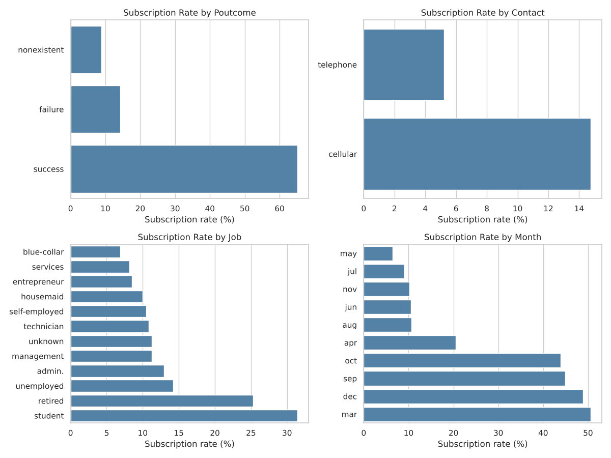
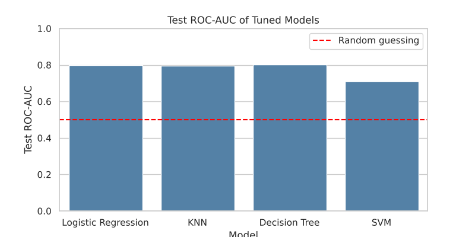

# Comparing Classifiers: Bank Marketing

**Notebook:** [prompt_III.ipynb](prompt_III.ipynb)

## Goal
A Portuguese bank calls clients to sell term deposits, but only about 11% of the people it calls actually sign up. That means a lot of time is spent on calls that go nowhere. In this project I tried to predict which clients are most likely to say yes. The bank could then call those people first and waste fewer calls.

## Data
I used the [UCI Bank Marketing dataset](https://archive.ics.uci.edu/dataset/222/bank+marketing). It has about 41,000 phone calls from 17 campaigns that ran between 2008 and 2010. For each call it has details about the client (age, job, education, loans), the call itself (phone type, month, number of calls) and the economy at the time (like interest rates).

Before modeling, I cleaned up a few things:
- I removed 12 duplicate rows.
- I dropped the `duration` column. Call length is only known after the call ends, so using it would be cheating.
- The `pdays` column used 999 to mean "never contacted before", so I replaced it with a simple yes/no column.
- Some columns had `unknown` values. I kept these as their own category instead of deleting the rows.

## What the data showed

- **Past behavior matters most.** Clients who said yes in an earlier campaign said yes again about 65% of the time.
- **Phone type matters.** Calls to cell phones worked about 3 times better than calls to landlines (15% vs 5%).
- **Students and retirees** were the most likely to sign up (31% and 25%).
- **Timing matters.** May had the most calls but the lowest success rate (about 6%). March, September, October and December were much better (around 45–50%).
- **Interest rates matter.** People signed up more when interest rates were low.
- **More calls doesn't help.** People who subscribed were usually reached in fewer calls.
- A chi-square test showed most of these differences are real and not just chance. The exceptions were having a housing loan or a personal loan, which made no real difference.

## Models
I compared four models: Logistic Regression, KNN, Decision Tree and SVM.

**First try (default settings, client info only).** None of the models did better than simply guessing "no" for everyone, which is already right 88.7% of the time. The Decision Tree overfit the training data, and SVM was very slow (about 43 seconds, compared with under a second for the others).

| Model | Train Time (s) | Test Accuracy |
|---|---|---|
| Logistic Regression | 0.08 | 0.887 |
| KNN | 0.04 | 0.879 |
| Decision Tree | 0.56 | 0.863 |
| SVM | 43.3 | 0.887 |

**Second try (more features and tuning).** I added the call and economy information and tuned each model with grid search and 5-fold cross-validation. I switched the metric to **ROC-AUC**. Accuracy looks good even when a model never finds a single subscriber. ROC-AUC instead checks how well the model puts likely subscribers ahead of unlikely ones, which is exactly what the bank needs for building a call list (0.5 = random guessing, 1.0 = perfect).

| Model | Test ROC-AUC |
|---|---|
| Decision Tree | 0.801 |
| Logistic Regression | 0.800 |
| KNN | 0.797 |
| SVM | 0.712 |

Three of the models ended up very close. SVM was clearly behind, and it was still the slowest.

## Recommendation
I recommend **Logistic Regression**. It scores almost the same as the best model, trains in seconds, and is easy to explain. It shows how much each factor raises or lowers someone's chance of signing up. The interest rate had the biggest effect: higher rates made people much less likely to subscribe.

In practice, if the bank only calls the **top 20%** of clients the model picks, it would still reach about **64% of all the people who would subscribe**. About 36% of those calls would succeed, compared with 11% when calling people at random. That's roughly 3 times more effective.

## Recommendations for the bank
1. **Use the model to build the call list** and start with the clients most likely to say yes.
2. **Call past "yes" clients first.** They are the easiest win.
3. **Use cell phone numbers** whenever possible.
4. **Don't keep calling the same person.** After 2–3 calls, the chances drop and you risk annoying them.
5. **Plan campaigns around timing.** Don't rely on May; March, September, October and December did much better, and so did periods of low interest rates.
6. **Make special offers for students and retirees,** since they respond the best.

## Next Steps
- Try other models, like Random Forest or Gradient Boosting, to see if they do better.
- Work out the real cost of a call and the value of a deposit, to decide how many people are worth calling.
- Test the model on a real campaign: compare a model-based call list with the usual list.
- Get newer data, since this dataset ends in 2010 and the economy has changed a lot since then.

## Files
- `prompt_III.ipynb`: the full analysis
- `data/`: the dataset and its description
- `images/`: charts from the notebook
- `CRISP-DM-BANK.pdf`: the research paper that describes the data
